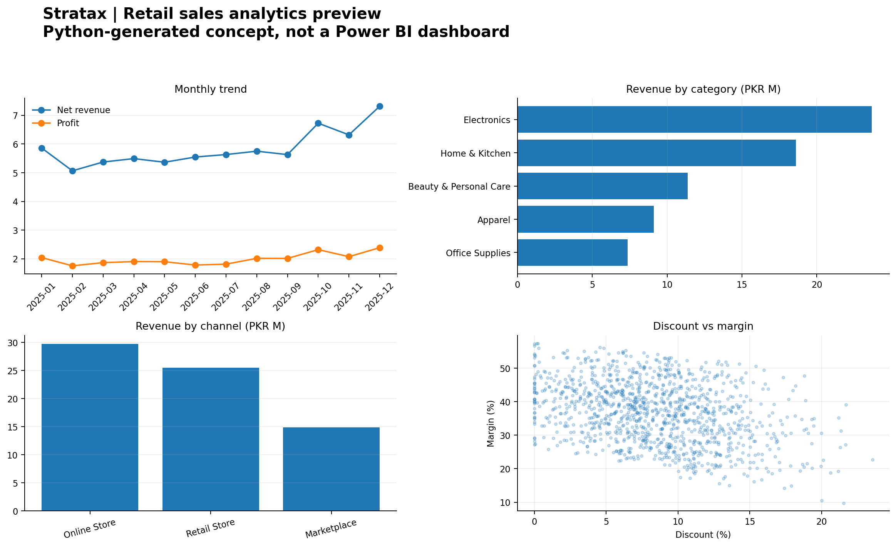

# Stratax | Analytics Portfolio

**Data Analytics • Business Intelligence • Dashboards • Reporting**

I build practical analytics projects that turn raw data into understandable reporting and business questions. This repository brings together case studies, reproducible analysis, SQL, Python, and dashboard work as the portfolio develops.

> **Transparency note:** The first case study uses synthetic data and is not client work. The Python charts are analysis previews, not a native Power BI report. The Power BI build guide provides the DAX and layout instructions needed to create the `.pbix` report separately.

## Featured case study

### Retail Sales Performance & Profitability Analysis

An end-to-end analytics exercise for a fictional Pakistani multi-channel retailer. The project examines revenue, profit, margin, discounts, categories, channels, and cities using Python, SQL, and a Power BI build plan.

- **Business question:** Where does revenue come from, and is that revenue profitable?
- **Tools:** Python, pandas, SQL, Power BI (DAX measures and build instructions)
- **Deliverables:** reproducible synthetic dataset, data-cleaning pipeline, SQL query pack, KPI tables, Python chart previews, DAX measures, and Power BI build/QA guide.
- **Data type:** synthetic, fictional, reproducible.

[Open the case study](project/retail-sales-dashboard/README.md) · [Power BI build guide](project/retail-sales-dashboard/docs/power-bi-build-guide.md) · [Illustrative findings](project/retail-sales-dashboard/outputs/illustrative_findings.md)

## Upcoming case studies

1. **Customer retention and cohort analysis:** repeat purchase, retention cohorts, and customer value using a documented dataset.
2. **Marketing campaign performance:** channel efficiency, conversion, and cost-per-acquisition analysis.

These are planned projects, not completed work.

## Tools and methods

Python · pandas · SQL · Power BI · DAX · Excel · KPI design · Data cleaning · Exploratory data analysis · Business reporting

## Contact

For collaboration or analytics work, contact me through my LinkedIn profile. Replace this line with a professional email or portfolio contact page before publishing publicly.
