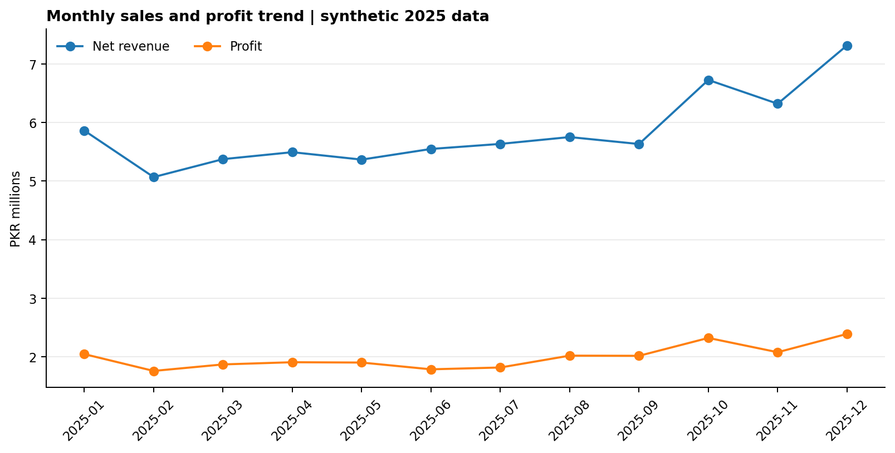
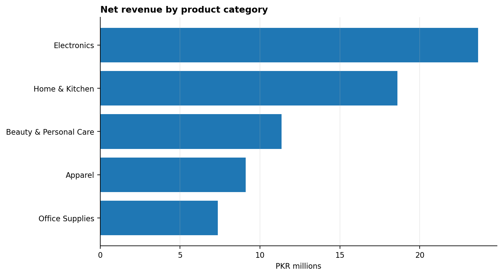
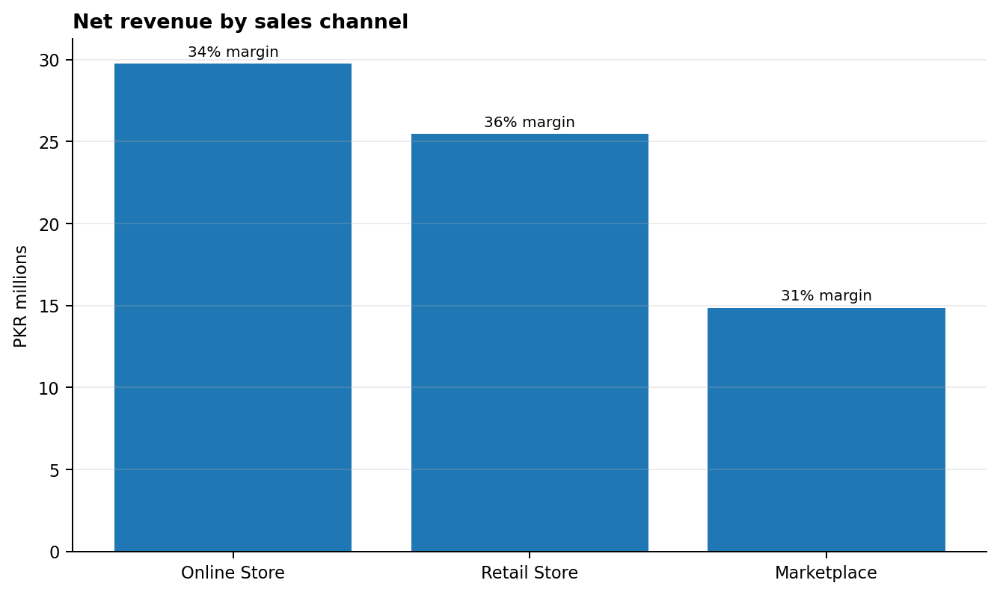
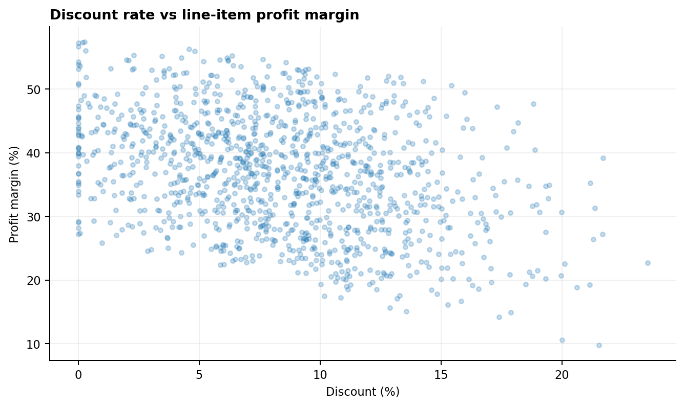

# Retail Sales Performance & Profitability Analysis

**Portfolio project by Stratax | SQL • Python • Power BI (build guide and DAX measures)**

> **Data disclosure:** This is an independent portfolio case study built on completely synthetic data. The fictional retailer, transactions, and findings do not represent a real company or a client engagement. The included image previews were generated in Python; they are not screenshots of a completed Power BI report. Use the supplied build guide to create the native `.pbix` report in Power BI Desktop.

## Business problem

A fictional multi-channel retailer needs to understand how sales, profit, product categories, discounts, cities, and sales channels perform across a year. Revenue alone can hide poor profitability, so the analysis compares revenue with profit and margin.

## Questions explored

1. How do net revenue and profit change month by month?
2. Which product categories contribute the most revenue and profit?
3. How do sales channels compare on revenue, profit margin, and discount rate?
4. Which cities contribute the most revenue?
5. What should a business investigate about discounting and profitability?

## Approach

1. **Generate data:** reproducible fictional 2025 transactions, using a fixed random seed.
2. **Clean and transform:** validate columns and numeric ranges, remove duplicate rows, parse dates, and derive gross revenue, discounts, net revenue, cost, profit, margin, and month.
3. **Analyze with Python:** use pandas to calculate KPI, monthly, category, channel, and city tables.
4. **Query with SQL:** provide reusable queries for core business questions.
5. **Design in Power BI:** provide DAX measures, a date-table definition, relationship guidance, suggested visuals, slicers, and QA checks.

## Repository contents

```text
project/retail-sales-dashboard/
├── data/
│   ├── raw/retail_sales_raw.csv
│   └── processed/retail_sales_clean.csv
├── docs/power-bi-build-guide.md
├── outputs/
│   ├── kpi_summary.csv
│   ├── monthly_trends.csv
│   ├── category_performance.csv
│   ├── channel_performance.csv
│   ├── city_performance.csv
│   ├── illustrative_findings.md
│   └── charts/
├── sql/analysis_queries.sql
└── src/
    ├── generate_synthetic_data.py
    └── analyze_sales.py
```

## Run the analysis

From the repository root:

```bash
pip install -r requirements.txt
python project/retail-sales-dashboard/src/generate_synthetic_data.py
python project/retail-sales-dashboard/src/analyze_sales.py
```

The scripts regenerate the synthetic raw data, cleaned dataset, KPI tables, findings, and Python charts.

Run quality checks with `pip install -r requirements-dev.txt` followed by `python -m pytest project/retail-sales-dashboard/tests -q`.

## Preview

### Monthly revenue and profit



### Revenue by category



### Revenue and margin by channel



### Discount versus line-item margin



### Dashboard concept


## Key findings

The generated figures are written to [`outputs/illustrative_findings.md`](outputs/illustrative_findings.md) and the exact summary metrics to [`outputs/kpi_summary.csv`](outputs/kpi_summary.csv). As this is a synthetic dataset, these findings are used to demonstrate analysis workflow only; they should not be presented as evidence about a real business.

## Power BI next step

Follow [`docs/power-bi-build-guide.md`](docs/power-bi-build-guide.md) to build the `.pbix` report and export a report screenshot. Once created, add the native file or a shareable report image to the project and update this README with the actual Power BI screenshot.

## Limitations

Synthetic data, simplified product costs, no shipping/fulfillment fees, taxes, returns, inventory, marketing spend, fees, or verified customer behaviour. No causal claims or client-impact claims are supported.

## Skills demonstrated

Python, pandas, SQL, data cleaning, exploratory data analysis, KPI design, business intelligence, data visualization, profitability analysis, dashboard planning, and DAX measure design.
